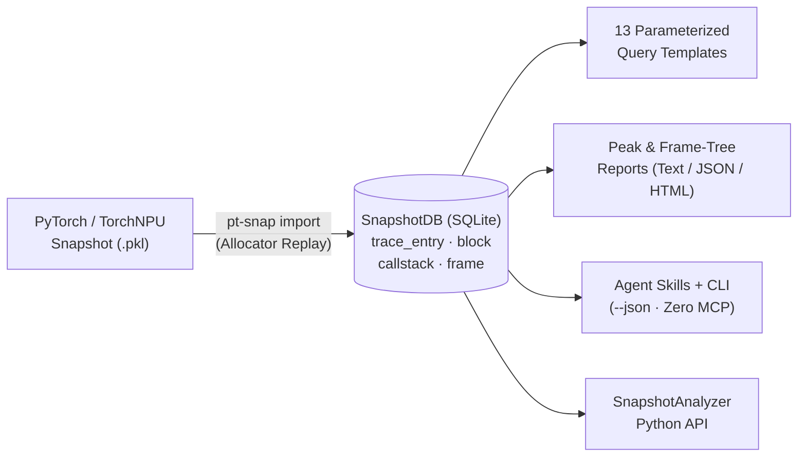

# pt-snap-cli

[](https://pypi.org/project/pt-snap-cli/)
[](https://pypi.org/project/pt-snap-cli/)
[](LICENSE)
[](https://github.com/codeasier/pt-snap-cli/actions/workflows/test.yml)

[中文文档](README_zh.md) | English

**High-efficiency, replay-enriched, agent-native CLI and Python toolkit for PyTorch GPU/NPU memory snapshot forensics.**

`pt-snap-cli` (`pt-snap`) transforms opaque PyTorch memory snapshot `.pkl` dumps into an indexed, relational **SnapshotDB (SQLite)** through a full allocator replay. Inspect peak occupancy, same-event allocator fragmentation, block lifecycles, leak candidates, and interactive frame-level memory flamegraphs in milliseconds—from your terminal, Python scripts, or AI coding agents—without needing PyTorch or a GPU/NPU environment offline.



## Why `pt-snap`?

| Dimension | Raw `.pkl` / Ad-hoc Scripts / Static HTML | `pt-snap-cli` (`SnapshotDB`) |
| --- | --- | --- |
| **Efficiency** | Re-parses multi-hundred-MB pickles on every question; heavy browser DOM on large traces | **Import once, query in milliseconds.** Indexed SQLite with SHA-256 cache reuse, read-only `mode=ro` queries, `--timeout` deadlines, and bounded dataset work budgets |
| **Data Structure** | Deeply nested dicts/lists; implicit pool counters and unlinked alloc/free events; repeated inline callstack strings | **Replay-enriched relational schema.** Post-event `allocated`/`active`/`reserved` counters, explicit `allocEventId → freeEventId` block lifecycles, deduplicated `callstack` table, and lossless ordered `(filename, line, name)` `frame` arrays |
| **Analysis Depth** | Visual timeline inspection or custom one-off Python loops | **13 built-in query templates + composite reports.** Same-event `reserved - active` gap analysis, peak callstack attribution with coverage metrics, leak candidate & lifetime buckets, and standalone interactive HTML memory-tree flamegraphs |
| **Agent Readiness** | Raw dumps overflow context windows; unstructured output causes unit/denominator hallucinations | **Agent-native CLI (no MCP server needed).** Deterministic `--json` envelopes, machine-readable `capabilities` & column semantics, `--stack-bytes` token budgeting, honest `has_more`/`truncated` flags, and 6 installable diagnostic skills |

### 1. High Efficiency — Import Once, Query in Milliseconds

- **Zero Accelerator Dependency Offline**: Offline import, querying, and reporting require only **Python 3.10+** and standard SQLite—no PyTorch, CUDA, or CANN runtime needed on your analysis machine.
- **Cryptographic Cache Reuse**: `pt-snap import` records source `SHA-256`, import format version, and device selection in `pt_snap_metadata`. Re-importing an unchanged snapshot reuses the validated `.db` in `<1 ms`.
- **Deduplicated Storage**: Callstacks and structured frames are interned once across all devices rather than repeated on every trace event, drastically shrinking disk footprint and scan I/O.
- **Bounded & Predictable Execution**: Every analysis opens SQLite with `mode=ro`, reuses cached connections in `SnapshotAnalyzer`, enforces wall-clock `--timeout` via SQLite progress handlers, and bounds sharded dataset queries with explicit work budgets (`--max-work-rows`, `--max-work-bytes`, `--max-scratch-db-bytes`).

### 2. Friendlier, Replay-Enriched Data Structure (`SnapshotDB`)

Instead of dumping raw pickle dictionaries directly into tables, `pt-snap` replays the allocator state machine during import and materializes explicit relational entities:

| Table | What Replay Materializes | Why It Is Easier to Query |
| --- | --- | --- |
| `trace_entry_<device>` | Chronological events (`alloc`, `free_requested`, `free_completed`, `segment_alloc`, `segment_free`, `segment_map`, `segment_unmap`, `workspace_snapshot`) | Every row carries exact post-event **`allocated`**, **`active`**, and **`reserved`** byte counters plus `callstackId` |
| `block_<device>` | Full memory block lifecycle (`id`, `address`, `size`, `requestedSize`, `state`, `allocEventId`, `freeEventId`) | Instantly join an allocation to its completion event, compare alignment overhead (`size` vs. `requestedSize`), and separate dynamic blocks (`id >= 0`) from preexisting/static blocks (`id < 0`, `allocEventId = -1`) |
| `callstack` | Deduplicated callstack text shared across all devices | Group or filter by `callstackId` without scanning megabytes of repeated stack strings |
| `frame` & `callstack_frame` | Lossless ordered `(filename, line, name)` frame tuples and `position` index (Format 3) | Build exact caller-to-callee memory trees and handle recursive frames or special characters without fragile regex/colon splitting |
| `dictionary` & `pt_snap_metadata` | Self-describing enum key/value mappings and provenance metadata | Portable, self-contained SQLite files that remain compatible across v1 (inline text), v2 (deduplicated text), and v3 (structured frame) layouts |

### 3. Deep Forensic Analysis Capabilities

- **Peak Memory & Same-Event Fragmentation (`report peak-memory`)**: Automatically locates independent `allocated`, `active`, and `reserved` peak events, computes **same-event allocator gaps** (`reserved - active` and `reserved - allocated` at the exact peak event instead of misleadingly subtracting peaks from different timestamps), and attributes live blocks to callstacks with explicit `coverage_percent` and `included_bytes`.
- **Frame-Level Live Memory Flamegraphs (`report memory-tree`)**: Decomposes live active memory at any `event_id` into a caller-first frame hierarchy (`size_bytes` inclusive vs. `self_bytes` exclusive). Export to terminal text, JSON, or a **self-contained interactive HTML flamegraph** (`--format html`) with zoom, full-tree search, and keyboard navigation where even tiny or zero-byte frames stay reachable.
- **Lifecycle, Retention & Leak Candidate Forensics**:
  - Distinguish unfreed dynamic survivors (`leak_detection`), stream-deferred frees (`free_requested` vs. `free_completed`), and pre-snapshot occupancy (`preexisting_live`).
  - Analyze block duration distributions by event-ID distance (`freed_block_lifetime`).
- **Multi-Format & Sharded Scale**: Analyze standalone `.db` files, native sharded datasets (`--events-per-slice`), msinsight-compatible exports (`--format msinsight`), or split multi-device pickles into replay-validated per-device slices (`pt-snap split`).

### 4. Agent-Native CLI by Design

`pt-snap` is engineered so AI coding agents (Claude Code, Cursor, Codex, OpenCode, Cline) can diagnose complex OOMs and leaks reliably **without an MCP server**:

- **Self-Discoverable Contracts**: `pt-snap capabilities --json` and `pt-snap query --template-info <name> --json` expose parameter schemas, `semantics_version`, column `units` (`bytes`, `percent`, `event_id`), `metric_semantics`, `denominator`, `sentinel` (`-1`), and `interpretation_limits`—preventing agents from hallucinating units or denominators.
- **Context-Window Budgeting (`--stack-bytes`)**: Deep PyTorch callstacks quickly exhaust LLM context windows. Passing `stack_bytes` (e.g., `--stack-bytes 256`) returns a UTF-8-safe prefix plus canonical `stack_id`, `stack_truncated`, and `stack_event_id`, allowing the agent to rank hundreds of groups compactly and fetch full stacks via `event(id=stack_event_id)` only for top suspects.
- **Honest Completeness Signals**: Every JSON response reports `total`, `returned`, `has_more`, `truncated`, and `total_is_exact`. Agents know immediately when a `LIMIT` or `top_n` window is partial and can widen the window or pass `--exact-total`.
- **Strict Parameter Validation & Error Envelopes**: Misspelled parameters (e.g., `min_sze`) fail fast with `INVALID_PARAMETER` and accepted keys instead of silently running unfiltered SQL. On `--json` failure, `stdout` stays empty while `stderr` emits a structured error object with `code`, `message`, and actionable `hint`.
- **6 Bundled Agent Skills**: Installable in one command (`pt-snap skill install`) to guide agents through read-only preflight, bounded evidence gathering, and output recovery.

---

## Start Here

| Your input or goal | Next step |
| --- | --- |
| Existing `.db` or complete dataset | [Inspect → query → report](docs/en/quickstart.md#step-2-inspect-the-target-and-choose-a-device); no import required |
| Trusted pickle | [Default single-DB import](docs/en/quickstart.md#step-1-import-only-if-needed) |
| No snapshot yet | [Collection prerequisites and entry points](docs/en/quickstart.md#need-to-collect-a-snapshot) |
| Ask an agent to analyze | [Install → restart → verify → ask](docs/en/skills.md#first-agent-session) |

## Installation

Requires **Python 3.10+**. Offline import/analysis needs no PyTorch or accelerator;
collection uses the workload's compatible GPU/NPU environment.

```bash
python -m pip install pt-snap-cli
```

For a source checkout and contributor setup, see [Development](#development).

## Quick Start

If you already have a DB, skip import. Otherwise use only a **trusted** pickle:
its deserialization can execute arbitrary code; the `builtins` restriction does
not make `pt-snap import` a sandbox.

```bash
pt-snap import snapshot.pkl
pt-snap overview snapshot.pkl.db --json
# Replace 0 with a device returned by overview.
pt-snap query snapshot.pkl.db --device 0 --template-use memory_peak --json
pt-snap report peak-memory snapshot.pkl.db --device 0 --metric active --limit 20
```

Generate an interactive HTML frame-level memory flamegraph at the peak event (for example, event `100`):

```bash
pt-snap report memory-tree snapshot.pkl.db --device 0 --event-id 100 --format html > memory-tree.html
```

Default import writes `snapshot.pkl.db` beside the pickle and updates project
`.pt-snap/focus.json` in the current directory. Add `--no-focus` to avoid that
focus change, not to prevent DB replacement: a standalone cache miss/`--force`
can replace an existing same-named DB; choose another `--output-dir` if needed.
The explicit-path inspection/query/report commands do not persist
focus or modify source data. The [walkthrough](docs/en/quickstart.md) explains
byte units, allocated/active/reserved counters, expected output and partial reports.

### Other Input Formats

- [Native sharded import](docs/en/quickstart.md#optional-import-a-native-sharded-dataset): opt in with `--events-per-slice`; not msinsight-compatible.
- [Explicit msinsight export](docs/en/quickstart.md#optional-export-an-msinsight-compatible-dataset): separate compatibility and no-replace rules, even with `--force`.
- [Replayable pickle splitting](docs/en/splitting.md): one split strategy and a new output directory; separate from dataset import.
- [Complete-dataset addressing](docs/en/sharded-snapshotdb.md#complete-dataset-focus-and-addressing-p1), [global built-in support](docs/en/querying.md#dataset-global-built-in-support-p3), and [recorded interoperability acceptance](docs/en/interop-acceptance.md): advanced contracts and evidence, not prerequisites for a first report.

Native reuse retains content verification and disposable validation receipts.
Compatible reuse checks source identity, complete member inventory, required
schema and event endpoints, not database bytes or arbitrary row values; queries
still perform independent admission. Parser-v2 caches require a new output
directory for parser-v3 export, never replacement. See the
[cache and preservation contract](docs/en/sharded-snapshotdb.md).

## Built-in Query Templates & Reports

Use `pt-snap query --list` or `pt-snap capabilities --json` to inspect all 13 built-in templates and their parameter/output schemas:

| Category | Template / Command | Purpose |
| --- | --- | --- |
| **Basic** | `event` | Filter trace events by ID bounds, action code, size, stream, or compact `stack_bytes` |
| **Basic** | `block` | Filter memory blocks by size, state, address, or lifecycle event bounds |
| **Basic** | `allocation` | Query `(id, allocated, active, reserved)` timeline trajectory |
| **Basic** | `event_frames` | Read the ordered `(position, filename, line, name)` frame array for a specific event (Format 3) |
| **Statistical** | `memory_peak` | Independent `allocated`, `active`, and `reserved` maxima and earliest peak event IDs |
| **Statistical** | `allocator_gap` | Peak events plus same-event `reserved - active` and `reserved - allocated` fragmentation gaps |
| **Statistical** | `active_blocks_at_event` | Enumerate blocks live at `event_id` (`allocEventId <= E < freeEventId` or unfreed), with optional static/preexisting blocks |
| **Statistical** | `callstack_analysis` | Aggregate count, total/min/max/average size across all stack-bearing trace actions |
| **Business** | `active_memory_callstack_at_event` | Group active memory at `event_id` by allocation callstack with byte share percentages |
| **Business** | `active_memory_frame_tree_at_event` | Caller-first tree breakdown (`size_bytes` inclusive vs. `self_bytes` exclusive) at `event_id` |
| **Business** | `leak_detection` | Find dynamic blocks allocated during capture that never recorded a `free_completed` event |
| **Business** | `preexisting_live` | Summarize pre-capture blocks (`allocEventId = -1`) still live at `event_id` |
| **Business** | `freed_block_lifetime` | Bucket completed block lifecycles by `freeEventId - allocEventId` event distance |
| **Report** | `report peak-memory` | One-shot `allocator_gap` + `active_memory_callstack_at_event` with coverage and completeness metadata |
| **Report** | `report memory-tree` | Text, JSON, or self-contained interactive HTML flamegraph of live memory by call frame |

## Commands

| Command | Description |
|---------|-------------|
| `pt-snap focus` | Set and manage analysis focus (database + device) |
| `pt-snap import <snapshot.pkl>` | Import a PyTorch memory snapshot pickle into a SnapshotDB |
| `pt-snap split <snapshot.pkl>` | Create replayable per-device snapshot slices |
| `pt-snap metadata [database.db]` | Inspect SnapshotDB import provenance and compatibility metadata |
| `pt-snap capabilities` | List CLI version, query template contracts, and bundled skills |
| `pt-snap overview [database.db]` | Read-only device list, per-device event-id bounds, and import-metadata status |
| `pt-snap query` | Run memory analysis queries |
| `pt-snap report` | Generate higher-level memory analysis reports |
| `pt-snap report memory-tree --event-id <id>` | Frame-level live-memory breakdown; `--format html` emits an interactive flamegraph |
| `pt-snap config` | Manage global configuration |
| `pt-snap skill` | List and install bundled agent skills |

`pt-snap --help` includes an agent hint: prefer `--json` on the command that supports it, start with the `pt-snap-helper` skill, use `pt-snap capabilities --json` and `pt-snap overview --json` before diagnosing, and check availability with `pt-snap skill list --json`. `focus`, `import`, `split`, `query`, `config`, `capabilities`, `overview`, `metadata`, `report peak-memory`, and `skill list/install/upgrade/uninstall` accept `--json`.

Peak reports expose attribution completeness and same-event active-byte coverage;
group percentages use included bytes after filtering and ranking. See the
[report guide](docs/en/querying.md#report-command) before interpreting a capped breakdown.

Standalone imports and new native/compatible datasets preserve ordered frames.
Use standalone `event_frames` (dataset `event` exposes `frames`), or `report memory-tree --event-id 100 --format html > memory-tree.html`
to explore event-time occupancy by caller path. See
[frame memory breakdown](docs/en/querying.md#frame-memory-breakdown); older
text-only databases require re-importing the original snapshot.
`report memory-tree` also accepts `--json`. The HTML view has full-tree search and
keyboard-accessible child lists, so tiny and zero-byte frames remain reachable.

Dataset work limits are configurable with `--max-work-rows`, `--max-work-bytes`,
`--max-scratch-db-bytes`, environment variables, or immutable Python `QueryLimits`.
Defaults remain 100000 work rows / 64 MiB work bytes / 512 MiB scratch pages; see
[public dataset limits](docs/en/querying.md#public-dataset-limits) for precedence,
deep-pagination costs and all-or-error semantics.

Concurrent frame-tree queries on one Python analyzer use the latest request;
superseded queries raise `QueryCancelledError`. See [API cancellation semantics](docs/en/snapshot-analyzer-api.md#errors-and-scope).

## Agent Skills

Install bundled diagnostic workflows with `pt-snap skill install`. Agent integration uses skills plus the CLI; there is no MCP server. See the [Agent Skills guide](docs/en/skills.md).

```bash
# Install bundled skills for shared Agent Skills hosts (~/.agents/skills) and Claude Code (~/.claude/skills)
pt-snap skill install

# Verify installation status as machine-readable JSON
pt-snap skill list --json
```

| Bundled Skill | Role |
| --- | --- |
| `pt-snap-helper` | Entry router: inspects user goal and input type, runs `capabilities` + `overview` preflight, and dispatches to the right workflow |
| `pt-snap-setup` | Verifies or installs `pt-snap-cli` in the active Python environment with shebang/interpreter ownership checks |
| `pt-snap-ascend-npu-collect` | Guides Ascend NPU memory snapshot `.pkl` capture (works even before `pt-snap` CLI is installed) |
| `pt-snap-memory-peak-breakdown` | Explains active memory at peak events, callstack attribution, and static/preexisting occupancy |
| `pt-snap-memory-leak` | Diagnoses end-of-trace unfreed dynamic candidates vs. pending frees and preexisting memory |
| `pt-snap-memory-fragmentation` | Investigates `reserved - active` allocator gaps, `segment_map`/`segment_unmap` behavior, and pool pressure |

For long diagnostic stacks, opt into `stack_bytes` on `event` or
`active_memory_callstack_at_event`, or `report peak-memory --stack-bytes 256`.
See [compact callstack text](docs/en/querying.md#compact-callstack-text) for
identity, byte-budget metadata and full-text retrieval.

Ascend NPU capture can proceed without `pt-snap` when the host has loaded
`pt-snap-ascend-npu-collect`; the helper routes collection before CLI setup.
Analysis still requires the CLI and a SnapshotDB, with trusted import as a separate decision.

## Documentation

See the [documentation index](docs/README.md) for all English and Chinese guides.

| Topic | Guide |
|-------|-------|
| Getting started | [Quick Start](docs/en/quickstart.md) |
| Managing focus | [Focus Management](docs/en/focus-management.md) |
| Running queries | [Querying](docs/en/querying.md) |
| Splitting snapshots | [Splitting Snapshots](docs/en/splitting.md) |
| Agent skills | [Agent Skills](docs/en/skills.md) |
| Database format | [SnapshotDB Schema](docs/en/database.md) |
| Sharded protocols, native import and compatibility limits | [Sharded SnapshotDB protocol](docs/en/sharded-snapshotdb.md) |
| Python API | [SnapshotAnalyzer API](docs/en/snapshot-analyzer-api.md) |
| Result mapping utility | [ResultMapper API](docs/en/result-mapper-api.md) |

## Development

Use the repository's single [Development and Checks checklist](AGENTS.md#development-and-checks):
fixture provenance, pytest, Ruff, Black, **basedpyright**, and `git diff --check`.
It also explains environment isolation, browser tests and coverage gates.

```bash
python -m pip install -e ".[dev]"
```


For the regular suite use `pytest -m 'not slow'`. Default-capacity scale and
non-editable installed exporter tests are described in the
[dataset acceptance guide](docs/en/dataset-acceptance.md).

The supplemental platform workflow runs Python 3.13 non-slow tests on macOS and
Windows. Windows uses four deterministic, disjoint shards of the full non-slow
collection; macOS runs it in one job. All five jobs retain a 20-minute limit,
with at most two running concurrently. Each Windows shard validates exhaustive
coverage before execution and uploads its full collection/partition manifest
alongside JUnit results. No tests are skipped to meet the time limit. To reproduce
one Windows partition locally, run
`python .github/scripts/run_platform_tests.py --shard 0` (choose `--shard 0` through `--shard 3`);
add `--collect-only` to inspect the partition without executing tests.

### Building distributions

Build from a fresh checkout or a new worktree at the intended commit, with no
existing `build/` or `dist/` directories. Setuptools can reuse files in `build/lib`
on repeated builds, including modules deleted from the source tree; build dependency
isolation does not clean these intermediates. Inspect old outputs before removing
them yourself, or use a fresh worktree instead.

From that checkout's root:

```bash
python -m build                  # Build sdist and wheel
python .github/scripts/audit_wheel.py --wheel dist/<built-wheel>.whl
```

Replace `<built-wheel>` with the generated filename. The read-only audit compares
Python module paths and bytes with `src/`, and separately checks query YAML,
bundled skills, and snapshot license/provenance resources against the packaging
contract. Generated distribution metadata is allowed. A mismatch fails with the
affected paths; rebuild from a fresh source tree and audit again before using the
wheel. CI audits its wheel before installed-package acceptance; release separately
audits the actual wheel it uploads for publication.
