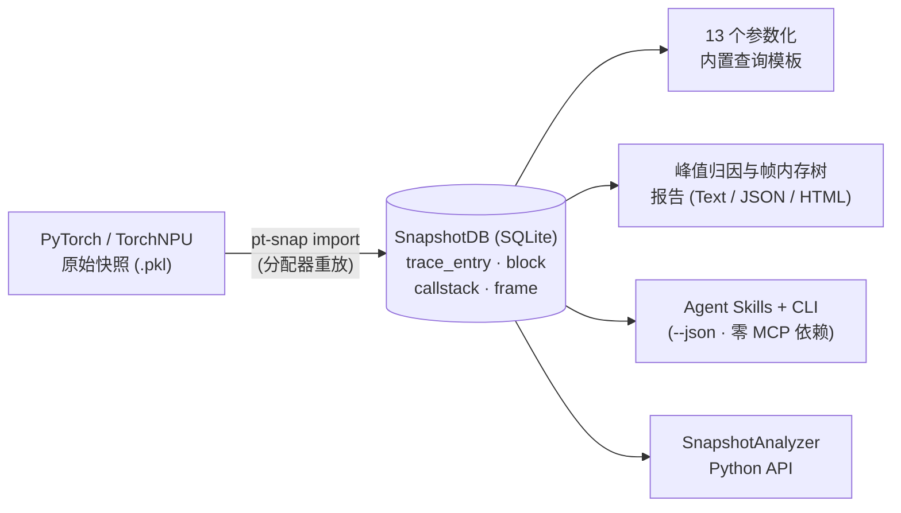

# pt-snap-cli

[](https://pypi.org/project/pt-snap-cli/)
[](https://pypi.org/project/pt-snap-cli/)
[](LICENSE)
[](https://github.com/codeasier/pt-snap-cli/actions/workflows/test.yml)

中文文档 | [English](README.md)

**面向 PyTorch GPU/NPU 内存快照诊断的高效、重放增强型、Agent 原生命令行与 Python 工具集。**

`pt-snap-cli`（`pt-snap`）通过完整的分配器状态机重放（Allocator Replay），将晦涩的 PyTorch 原始内存快照 `.pkl` 转换为带索引的关系型 **SnapshotDB（SQLite）**。无需在分析机上安装 PyTorch 或 GPU/NPU 驱动，即可在毫秒级完成峰值内存归因、同事件碎片化差距（`reserved - active`）诊断、内存块完整生命周期追踪、泄漏候选筛查以及交互式调用栈帧火焰图生成——无论是在终端、Python 脚本还是 AI 编程 Agent 中。



## 为什么选择 `pt-snap`？

| 维度 | 原始 `.pkl` / 临时脚本 / 静态大网页 | `pt-snap-cli`（`SnapshotDB`） |
| --- | --- | --- |
| **高效性** | 每次提问都要重新反序列化数百 MB 的 pickle；超大轨迹下浏览器 DOM 极易卡顿 | **一次导入，毫秒级查询。** SQLite 索引加速 + SHA-256 缓存复用（命中 `<1 ms`）、只读 `mode=ro` 连接、`--timeout` 进度中断与显式数据集工作预算 |
| **数据结构** | 深层嵌套字典/列表；内存池水位隐式变化、申请与释放事件未关联、长调用栈重复存储 | **重放增强的关系型模型。** 每个事件后精确记录 `allocated`/`active`/`reserved` 水位，显式构建 `allocEventId → freeEventId` 块生命周期，跨设备去重 `callstack`，无损保留有序 `(filename, line, name)` 结构化帧（`frame`） |
| **分析能力** | 仅靠肉眼拖拽时间线，或每次手写一次性 Python 遍历逻辑 | **13 个内置查询模板 + 高阶组合报告。** 支持同事件 `reserved - active` 碎片分析、带覆盖率的峰值调用栈归因、泄漏候选与生命周期分桶、单文件交互式 HTML 内存帧火焰图 |
| **Agent 友好** | 原始输出瞬间撑爆上下文窗口；缺少字段单位与分母约定易引发大模型幻觉 | **专为 Agent 设计的 CLI（无需 MCP Server）。** 确定性 `--json` 信封、可自发现的 `capabilities` 与字段语义契约、`--stack-bytes` 上下文预算控制、诚实的 `has_more`/`truncated` 完整性标记，以及 6 个随包诊断 Skill |

### 1. 高效：一次重放导入，毫秒级受控查询

- **离线分析零加速器依赖**：离线导入、查询与报告仅需 **Python 3.10+** 与标准 SQLite，分析环境无需安装 PyTorch、CUDA 或 CANN。
- **哈希校验缓存复用**：`pt-snap import` 在 `pt_snap_metadata` 中记录源文件 `SHA-256`、导入格式版本及设备选择；未发生变化的快照重复导入时在 `<1 ms` 内直接复用。
- **跨设备调用栈与帧去重**：海量事件共享少量调用栈与代码帧，`callstack` 与 `frame` 表仅存储唯一条目并通过整数 ID 关联，显著降低磁盘占用与扫描开销。
- **严格只读与资源边界**：所有分析均以 `mode=ro` 打开 SQLite，支持 SQLite progress handler 驱动的 `--timeout` 超时控制，以及面向分片数据集的显式工作上限（`--max-work-rows`、`--max-work-bytes`、`--max-scratch-db-bytes`）。

### 2. 更友好的数据结构：分配器重放构建的 `SnapshotDB`

`pt-snap` 并非简单地把 pickle 字典平铺进数据库，而是在导入阶段完整重放内存分配器状态机，提炼出直观、易查询的关系表：

| 数据表 | 重放阶段构建的核心信息 | 为什么对分析更友好 |
| --- | --- | --- |
| `trace_entry_<device>` | 按时序排列的分配器动作（`alloc`、`free_requested`、`free_completed`、`segment_alloc`、`segment_free`、`segment_map`、`segment_unmap`、`workspace_snapshot`） | 每条事件直接附带该时刻之后的精确 **`allocated`**、**`active`**、**`reserved`** 字节水位与 `callstackId` |
| `block_<device>` | 内存块完整生命周期（`id`、`address`、`size`、`requestedSize`、`state`、`allocEventId`、`freeEventId`） | 直接关联某次分配何时释放、对比对齐损耗（`size` vs `requestedSize`），并清晰区分采集中动态分配块（`id >= 0`）与采集前已存在的存量/静态块（`id < 0`, `allocEventId = -1`） |
| `callstack` | 跨设备共享的去重调用栈文本 | 按 `callstackId` 高效聚合，无需反复扫描重复字符串 |
| `frame` & `callstack_frame` | 无损有序的 `(filename, line, name)` 结构化帧元组与 `position` 序号（Format 3） | 直接构建从外层调用者到内层分配点的内存占比树，妥善处理递归帧与特殊字符，无需脆弱的冒号/换行文本切分 |
| `dictionary` & `pt_snap_metadata` | 自描述的枚举值映射字典与来源校验元数据 | 单文件自包含，同时无感兼容 v1（内联文本）、v2（去重文本）和 v3（结构化帧）数据库布局 |

### 3. 深度分析能力：从宏观水位到逐帧火焰图

- **峰值归因与同事件碎片差距（`report peak-memory`）**：独立定位 `allocated`、`active`、`reserved` 各自的峰值事件，计算**同一事件时刻**的 `reserved - active` 与 `reserved - allocated` 差距（避免将不同时刻的峰值直接相减产生误导），并按调用栈归因存活内存及输出 `coverage_percent` 与 `included_bytes`。
- **逐帧存活内存树与交互式火焰图（`report memory-tree`）**：在任意 `event_id` 将存活内存按调用链拆解为包含子节点占用（`size_bytes`）与自身终点占用（`self_bytes`），支持输出终端文本、JSON 或**零服务端依赖的单文件交互式 HTML 火焰图**（`--format html`），内置全树搜索与键盘导航，极小或零字节帧也可直达。
- **生命周期、延迟释放与泄漏候选分析**：
  - 区分采集中未完成释放的动态块（`leak_detection`）、流同步前挂起释放的块（`free_requested` 但未 `free_completed`）以及采集前存量块（`preexisting_live`）。
  - 按 `freeEventId - allocEventId` 事件跨度统计已释放块的生命周期分布（`freed_block_lifetime`）。
- **多形态数据支持**：支持独立 `.db` 单库、原生分片数据集（`--events-per-slice`）、msinsight 兼容数据集导出（`--format msinsight`）以及按设备/切片的可回放 pickle 拆分（`pt-snap split`）。

### 4. 原生 Agent 友好的命令行设计

`pt-snap` 从底层交互协议上为 Claude Code、Cursor、Codex、OpenCode、Cline 等 AI Agent 量身定制，**无需额外部署 MCP Server**：

- **契约自发现（防幻觉）**：`pt-snap capabilities --json` 与 `pt-snap query --template-info <name> --json` 完整输出参数类型/枚举、语义版本（`semantics_version`）、输出列单位（`bytes`、`percent`、`event_id`）、分母含义（`denominator`）、哨兵值（`-1`）及解读边界（`interpretation_limits`）。
- **上下文窗口预算控制（`--stack-bytes`）**：深度学习调用栈往往极长；通过 `--stack-bytes 256` 可按 UTF-8 安全边界截断调用栈文本，同时保留唯一身份 `stack_id`、`stack_truncated` 与定位事件 `stack_event_id`，让 Agent 先低成本扫描全局排名，再对关键嫌疑项按需拉取完整调用栈。
- **诚实的完整性信号**：所有 `--json` 查询与报告均包含 `total`、`returned`、`has_more`、`truncated` 与 `total_is_exact`，防止 Agent 将受 `LIMIT` 或 `top_n` 截断的局部窗口误判为全量数据。
- **严格参数校验与结构化错误信封**：拼写错误的参数（如 `min_sze`）会立即触发 `INVALID_PARAMETER` 并提示合法参数名，绝不静默退化为无过滤全表查询；`--json` 失败时 `stdout` 保持为空，`stderr` 输出带 `code`、`message`、`hint` 的标准 JSON 错误对象。
- **随包内置 6 个诊断 Skill**：一行 `pt-snap skill install` 即可将标准化预检、有界取证与截断恢复工作流安装到主流 Agent 宿主目录。

---

## 从这里开始

| 你的输入或目标 | 下一步 |
| --- | --- |
| 已有 `.db` 或完整数据集 | [检查 → 查询 → 报告](docs/zh/quickstart.md#第二步检查目标并选择设备)，无需导入 |
| 可信 pickle | [默认单库导入](docs/zh/quickstart.md#第一步仅在需要时导入) |
| 尚无快照 | [采集前提与入口](docs/zh/quickstart.md#尚需采集快照) |
| 让 Agent 帮忙分析 | [安装 → 重启 → 验证 → 提问](docs/zh/skills.md#首次-agent-会话) |

## 安装

需要 **Python 3.10+**。离线导入/分析无需 PyTorch 或加速器；采集则在工作负载对应的
兼容 GPU/NPU 环境中进行。

```bash
python -m pip install pt-snap-cli
```

源码 checkout 与贡献者安装见[开发](#开发)。

## 快速开始

已有 DB 就跳过导入；否则只使用**可信** pickle。反序列化可能执行任意代码，
`builtins` 限制不代表 `pt-snap import` 是沙箱。

```bash
pt-snap import snapshot.pkl
pt-snap overview snapshot.pkl.db --json
# 将 0 替换为 overview 实际返回的设备。
pt-snap query snapshot.pkl.db --device 0 --template-use memory_peak --json
pt-snap report peak-memory snapshot.pkl.db --device 0 --metric active --limit 20
```

在指定事件（例如事件 `100`）生成按调用栈帧拆解的交互式 HTML 内存火焰图：

```bash
pt-snap report memory-tree snapshot.pkl.db --device 0 --event-id 100 --format html > memory-tree.html
```

默认导入在 pickle 旁写出 `snapshot.pkl.db`，并更新当前目录的项目
`.pt-snap/focus.json`；加 `--no-focus` 只避免 focus 变化，不防止 DB 替换：单库缓存
未命中或 `--force` 可能替换同名 DB，必要时选择其他 `--output-dir`。显式路径的检查/查询/报告
不持久化 focus，也不修改源数据。[完整示例](docs/zh/quickstart.md)解释字节单位、
allocated/active/reserved 指标、预期输出和报告不完整的情况。

### 其他输入格式

- [原生分库导入](docs/zh/quickstart.md#可选导入原生分库数据集)：用 `--events-per-slice` 显式启用，不是 msinsight 兼容格式。
- [显式 msinsight 导出](docs/zh/quickstart.md#可选导出-msinsight-兼容数据集)：独立的兼容合同与 no-replace 规则，`--force` 也不替换。
- [可回放 pickle 拆分](docs/zh/splitting.md)：只选一种拆分策略并使用新目录，与数据集导入不同。
- [完整数据集寻址](docs/zh/sharded-snapshotdb.md#完整数据集-focus-与寻址p1)、[全局内建支持](docs/zh/querying.md#数据集全局内建支持p3)和[已记录的互操作验收](docs/zh/interop-acceptance.md)：按需查看高级合同与证据，不是第一份报告的前置条件。

原生复用保留内容校验与可丢弃的校验记录。兼容复用检查源身份、完整成员清单、必需
schema 和事件端点，不验证数据库字节或任意行值；查询仍独立进行准入校验。
parser-v2 缓存须换新输出目录导出 parser-v3，不会被替换。详见
[缓存及保留合同](docs/zh/sharded-snapshotdb.md)。

## 内置查询模板与报告

可执行 `pt-snap query --list` 或 `pt-snap capabilities --json` 查看全部 13 个内置查询模板及其参数与输出契约：

| 分类 | 模板 / 命令 | 用途说明 |
| --- | --- | --- |
| **Basic** | `event` | 按事件 ID 范围、动作码、大小、流或紧凑 `stack_bytes` 过滤分配器事件 |
| **Basic** | `block` | 按块大小、状态码、地址或分配/释放事件范围检索内存块 |
| **Basic** | `allocation` | 查询 `(id, allocated, active, reserved)` 内存水位时间线 |
| **Basic** | `event_frames` | 读取指定事件的有序 `(position, filename, line, name)` 结构化调用栈帧（Format 3） |
| **Statistical** | `memory_peak` | 获取 `allocated`、`active`、`reserved` 各自的最大值及最早达到峰值的事件 ID |
| **Statistical** | `allocator_gap` | 对比三类峰值事件，并计算同一事件时刻的 `reserved - active` 与 `reserved - allocated` 碎片差距 |
| **Statistical** | `active_blocks_at_event` | 列出在 `event_id` 时刻仍存活的内存块（`allocEventId <= E < freeEventId` 或未释放），可选包含静态/存量块 |
| **Statistical** | `callstack_analysis` | 按调用栈聚合全部带栈事件的数量、总字节、最小/最大/平均大小 |
| **Business** | `active_memory_callstack_at_event` | 将 `event_id` 时刻的存活内存按分配调用栈聚合，计算字节占比 |
| **Business** | `active_memory_frame_tree_at_event` | 在 `event_id` 时刻按外层调用者优先构建逐帧内存树（含子树汇总 `size_bytes` 与本帧终点 `self_bytes`） |
| **Business** | `leak_detection` | 查找采集期间动态分配且直到结束仍未记录 `free_completed` 的泄漏候选块 |
| **Business** | `preexisting_live` | 统计采集开始前已分配（`allocEventId = -1`）且在 `event_id` 时刻仍存活的内存占用 |
| **Business** | `freed_block_lifetime` | 按 `freeEventId - allocEventId` 事件跨度对已完成释放的内存块进行生命周期分桶 |
| **Report** | `report peak-memory` | 一键组合 `allocator_gap` + `active_memory_callstack_at_event`，附带覆盖率与完整性元数据 |
| **Report** | `report memory-tree` | 输出指定事件时刻的终端文本树、JSON 树或单文件交互式 HTML 内存帧火焰图 |

## 命令

| 命令 | 说明 |
|------|------|
| `pt-snap focus` | 设置和管理分析焦点（数据库 + 设备） |
| `pt-snap import <snapshot.pkl>` | 将 PyTorch 原始内存快照导入 SnapshotDB |
| `pt-snap split <snapshot.pkl>` | 创建可回放的逐设备快照切片 |
| `pt-snap metadata [database.db]` | 查看 SnapshotDB 的导入来源与兼容性 metadata |
| `pt-snap capabilities` | 列出 CLI 版本、查询模板契约和随包 skill |
| `pt-snap overview [database.db]` | 只读输出设备列表、各设备 event id 边界和导入 metadata 状态 |
| `pt-snap query` | 运行内存分析查询 |
| `pt-snap report` | 生成高层内存分析报告 |
| `pt-snap report memory-tree --event-id <id>` | 按帧分层拆解存活内存；`--format html` 输出交互式火焰图 |
| `pt-snap config` | 管理全局配置 |
| `pt-snap skill` | 列出并安装随包 agent skill |

`pt-snap --help` 含 Agent 提示：在支持该选项的命令上优先使用 `--json`，从 `pt-snap-helper` skill 开始，诊断前先用 `pt-snap capabilities --json` 和 `pt-snap overview --json`，并用 `pt-snap skill list --json` 检查是否已安装。`focus`、`import`、`split`、`query`、`config`、`capabilities`、`overview`、`metadata`、`report peak-memory` 和 `skill list/install/upgrade/uninstall` 均接受 `--json`。

峰值报告会返回归因完整性及同事件 active 字节覆盖率；分组百分比以筛选和排名后的
included bytes 为分母。解读有上限的分组结果前，请参阅
[报告指南](docs/zh/querying.md#report-命令)。

单库及新导入的原生/兼容分片数据集均保留去重有序帧。单库用 `event_frames`、
数据集用 `event` 的 `frames` 查看帧，或执行
`report memory-tree --event-id 100 --format html > memory-tree.html`
按调用路径查看事件时刻的占用。详见[调用栈帧内存拆解](docs/zh/querying.md#调用栈帧内存拆解)；
旧文本数据库需要从原始快照重新导入。
`report memory-tree` 同样支持 `--json`。HTML 支持全树搜索和可键盘操作的子节点列表，
极小占用及零字节帧也能进入查看。

数据集工作预算可通过 `--max-work-rows`、`--max-work-bytes`、
`--max-scratch-db-bytes`、环境变量或不可变 Python `QueryLimits` 配置。
默认仍为 100000 工作行 / 64 MiB 工作字节 / 512 MiB scratch 页；优先级、
深分页成本和整次失败语义见[公开数据集预算](docs/zh/querying.md#公开数据集预算)。

同一 Python analyzer 的并发帧树查询以最新请求为准，旧请求抛出 `QueryCancelledError`。
详见 [API 取消语义](docs/zh/snapshot-analyzer-api.md#错误与范围)。

## Agent Skills

使用 `pt-snap skill install` 安装随包诊断工作流。Agent 集成入口是 skills 与 CLI，不再提供 MCP 服务器。详见 [Agent Skills 指南](docs/zh/skills.md)。

```bash
# 安装随包 Skill 到通用 Agent Skills 目录（~/.agents/skills）与 Claude Code 目录（~/.claude/skills）
pt-snap skill install

# 以机器可读 JSON 检查安装状态
pt-snap skill list --json
```

| 随包 Skill | 职责说明 |
| --- | --- |
| `pt-snap-helper` | 诊断总入口路由：根据用户目标与输入类型完成 `capabilities` + `overview` 预检，并分发至对应子工作流 |
| `pt-snap-setup` | 在当前 Python 环境中验证或安装 `pt-snap-cli`，校验 shebang 与解释器归属一致性 |
| `pt-snap-ascend-npu-collect` | 指导昇腾 NPU 内存快照 `.pkl` 采集（宿主已加载该 Skill 时无需预先安装 `pt-snap` CLI） |
| `pt-snap-memory-peak-breakdown` | 诊断峰值事件时刻的存活内存构成、调用栈归因及静态/存量内存占比 |
| `pt-snap-memory-leak` | 排查轨迹末尾未释放的动态分配候选块，区分挂起释放（pending free）与采集前存量块 |
| `pt-snap-memory-fragmentation` | 诊断 `reserved - active` 分配器差距、`segment_map`/`segment_unmap` 行为与内存池膨胀压力 |

诊断长调用栈时，可在 `event` 或 `active_memory_callstack_at_event` 上显式设置
`stack_bytes`，或使用 `report peak-memory --stack-bytes 256`。
身份、字节预算元数据及完整文本检索方式见[紧凑调用栈文本](docs/zh/querying.md#紧凑调用栈文本)。

宿主已加载 `pt-snap-ascend-npu-collect` 时，没有 `pt-snap` 也能进行昇腾 NPU 采集；
helper 会先路由采集，无需先安装 CLI。分析仍需要 CLI 和 SnapshotDB，可信导入是独立决定。

## 文档

全部中英文指南见[文档索引](docs/README.md)。

| 主题 | 指南 |
|------|------|
| 入门指南 | [Quick Start](docs/zh/quickstart.md) |
| Focus 管理 | [Focus Management](docs/zh/focus-management.md) |
| 运行查询 | [Querying](docs/zh/querying.md) |
| 拆分快照 | [拆分快照](docs/zh/splitting.md) |
| Agent skill | [Agent Skills](docs/zh/skills.md) |
| 数据库格式 | [SnapshotDB Schema](docs/zh/database.md) |
| 分片协议、原生导入与兼容边界 | [分片 SnapshotDB 协议](docs/zh/sharded-snapshotdb.md) |
| Python API | [SnapshotAnalyzer API](docs/zh/snapshot-analyzer-api.md) |
| 结果映射工具 | [ResultMapper API](docs/zh/result-mapper-api.md) |

## 开发

统一使用根 [Development and Checks 检查清单](AGENTS.md#development-and-checks)：
fixture provenance、pytest、Ruff、Black、**basedpyright** 和 `git diff --check`，
并在同一入口查看环境隔离、浏览器测试与覆盖率门槛。

```bash
python -m pip install -e ".[dev]"
```


常规套件可用 `pytest -m 'not slow'`。默认容量规模及非 editable 安装包导出测试见
[数据集验收指南](docs/zh/dataset-acceptance.md)。

补充的平台工作流在 macOS 和 Windows 上运行 Python 3.13 非 slow 测试。
Windows 将完整的非 slow 集合确定性地划分为四个互不重叠的分片；macOS 使用一个任务。
五个任务均保持 20 分钟上限，最多同时运行两个。每个 Windows 分片在执行前验证
划分无遗漏、无重复，并随 JUnit 结果上传完整的收集及分片清单。不会为了满足时间上限
而跳过测试。本地复现一个 Windows 分片可运行
`python .github/scripts/run_platform_tests.py --shard 0`（可选 `--shard 0` 至 `--shard 3`）；
增加 `--collect-only` 可仅检查划分，不执行测试。

### 构建分发包

请从目标提交的全新 checkout 或新 worktree 构建，确保没有已有的 `build/` 和
`dist/` 目录。重复构建时，setuptools 可能复用 `build/lib` 中的文件，包括源码中
已删除的模块；构建依赖隔离不会清理这些中间产物。自行删除旧产物前请先检查其内容，
也可以直接使用全新 worktree。

在该 checkout 的根目录运行：

```bash
python -m build                  # 构建 sdist 和 wheel
python .github/scripts/audit_wheel.py --wheel dist/<built-wheel>.whl
```

将 `<built-wheel>` 替换为实际生成的文件名。只读审计会将 Python 模块的路径和字节内容
与 `src/` 比对，并按打包合同独立检查查询 YAML、内置技能、snapshot 许可证及来源记录
资源，允许构建后端生成的分发元数据。发现不匹配时会失败并列出具体路径；请从全新源码树
重新构建并再次审计，通过后再使用 wheel。CI 在安装包验收前审计 wheel；release 会独立
审计实际上传用于发布的 wheel。
